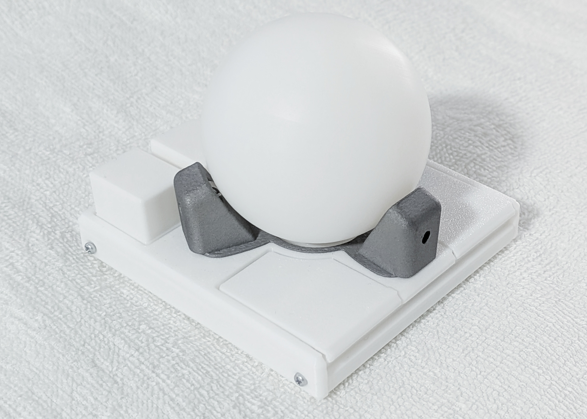
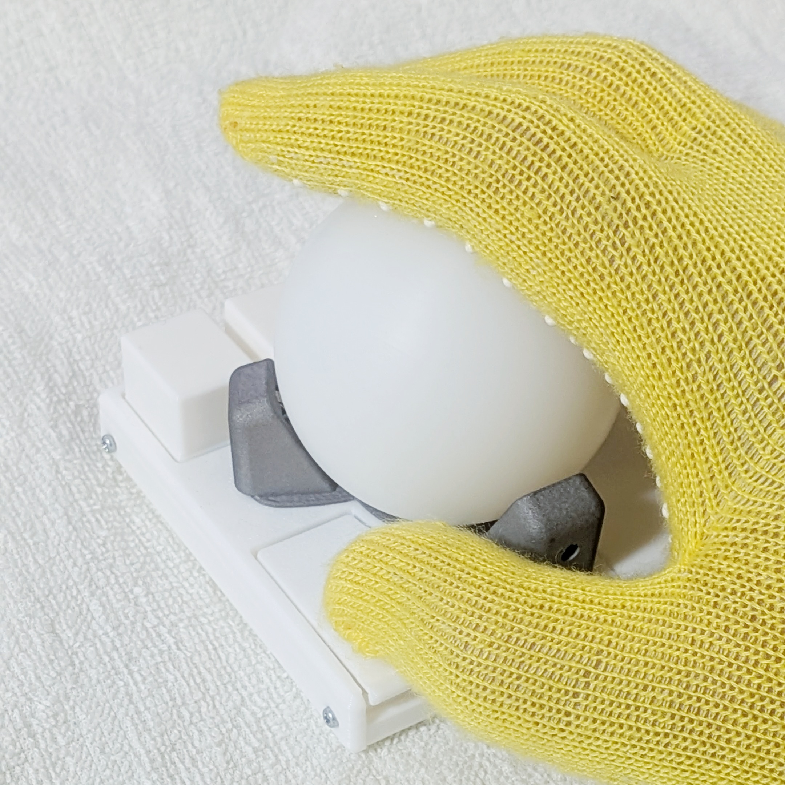

English | [日本語](README_ja.md)

> They say the trackball journey ends once you buy a Kensington SlimBlade Pro and an Elecom COMFY wrist rest.  
> But couldn't the case be made smaller?

# GOTOKU-55 Trackball

## What is this?
This is a **"part"** for a 55 mm trackball. To see where it fits, you need some background, in order.

### Ploopy Adept
The Adept is a trackball with a 44 mm ball (1.75 in ≈ 44.5 mm), developed by Ploopy, a small Canadian company. The design files and firmware are open source, but parts you source yourself may not fit dimensionally, so buying a kit or a fully assembled unit from the official Ploopy store is recommended.

- Link: [Adept Trackball](https://ploopy.co/adept-trackball/)

### Adept Anyball
Adept Anyball is a mod project that reworks the Adept case so that the ball rides on BTUs (ball transfer units). By choosing a case variant, you can use anything from a small 34 mm ball up to a 68 mm billiard ball. The files are published on GitHub, and you 3D print and assemble them yourself.

There is of course a 55 mm version, but its case is rather large, and many people seem to add a wrist rest to it.

- Link: [Adept Anyball](https://github.com/adept-anyball/)

#### Note: how trackballs support the ball
Most trackballs on the market today hold the ball on static supports, such as ceramic balls. Static supports are quiet, cheap and small, so they will likely stay the mainstream. On the other hand, they always have some friction, and many users have tried things like coating the ball to make it feel better.

Ball bearing supports had fallen out of use, but recently their comfort has been rediscovered, and they seem to be making a comeback: Elecom, for example, now has models with ball bearing supports in its IST and HUGE lines. Friction is low, so when you want to nudge the cursor just a little, precisely, they feel far better than static supports. This is not a special move. It happens all the time at a desk, so it makes a big difference.

Ploopy mainly uses ball bearing supports, but supporting the ball on special parts called BTUs (ball transfer units) has recently become popular. The Anyball project seems to be leading this BTU trend. A BTU is a large ball resting on a bed of tiny balls that let it roll smoothly. In industry, BTUs are used in conveyor tables for moving heavy loads, or as casters.  
A ball bearing turns only about its own axle, while a BTU lets the ball roll freely in any direction. That is why BTUs are sometimes called the ideal way to support a trackball ball.

### ploopy-adept-small-btu v4 (Slim)
A compact case for 34 mm / 38 mm balls by Fabricio Bastian, published within the Anyball project. It is made as low-profile as possible so that it can sit between the halves of a split keyboard, and its design is beautiful and refined.  
Going by the height of the buttons alone, it is probably lower than the Keychron Nape Pro, one of the smallest trackballs on the market. If you like low-profile keyboards, it is very appealing.

- Link: [adept-anyball/ploopy-adept-small-btu](https://github.com/adept-anyball/ploopy-adept-small-btu)

### GOTOKU-55
Putting a 55 mm ball on ploopy-adept-small-btu v4 is quite a stretch. On paper, the ball and the arm that holds it are so big that they almost cover the buttons. But this unpromising idea turned out to work surprisingly well once I built it.  
The lopsided look may surprise you, but it is not as huge as it looks. A 55 mm ball is certainly big for a trackball, but it is much smaller than a baseball.  
Also, something I had felt since I first saw the small-btu case: unlike a typical trackball, the ball is exposed down to its "southern hemisphere". You can wrap your thumb around it as if gripping it, which makes even precise movements steady and comfortable.

So I made an arm part (the "trackball support" in small-btu terms) that holds a 55 mm ball and fits this beautiful compact case. That is GOTOKU-55. The name comes from *gotoku* (五徳), the pronged trivet that holds a pot over a Japanese gas burner, which is what the arm part looks like. The 55 is the ball diameter in millimetres.

In most cases the arm part is all you need. The small-btu v4 case is polished and beautiful, so you can use it as is.

### The arm
There are three versions of the arm.

- **Ball bearing, one-piece version.** For printing in PLA.
- **Ball bearing, split version.** For metal printing. The arm is metal, and the center floor (the cover over the sensor lens) is a separate PLA part.
- **BTU, split version.** It works, but the shape is rather extreme. It uses the same sensor cover as the ball bearing split version.

A 55 mm ball is heavy, and you roll it with your palm. A PLA arm bends outward under this load. So I recommend printing the arm in metal with SLM (metal 3D printing, for example in stainless steel 316L). With a metal arm, the arm does not bend at all. A metal arm alone is enough to fix this problem.  
(If you think a better shape could solve this, I would be glad to hear from you.)

Use a split version for metal printing (the BTU arm comes only as a split version). The PLA floor goes in from below. It is held between the metal arm and the sensor lens, so the heavy metal arm does not press on the lens.

Ball bearings are cheap and comfortable. In most cases, I recommend ball bearings.  
BTUs are popular in the DIY trackball world, but they are expensive. A ball bearing rolls only in the direction at right angles to its axle. So when you roll the ball, some of the bearings slip a little, and when you twist the ball in place, all of them slip. A BTU rolls in any direction without slipping, and the difference is largest when you twist the ball. However, the Adept reads the ball with an optical sensor underneath, and that sensor cannot read the twist, so this brings no real functional benefit. And BTUs are very noisy.  
BTU mods are trendy, and hard to resist. Try it only if you are in it for the romance.

### The case
However, with a grip like mine, the stock v4 gets in the way. When I lay my thumb flat to press the front buttons, the corner of the case hits my finger.

So, for people who hold it this way, I also made a modified case that extends the front buttons all the way to the edge.
The screw holes and so on are unchanged from v4, so printing only the top is enough. But the front wall disappears and it looks a little bare, so I made a bottom as well.  
This extended-button case is compatible with v4, so you can use the case alone even with a small-btu arm, for example for a 34 mm ball.

Of the back buttons, only the one on your dominant-hand side is really usable. On a symmetrical trackball with a big ball, some buttons are bound to be awkward. But with a 55 mm ball, pressing a back button often means touching the ball too, which gets annoying. It costs the flat look of the beautiful v4 case, which is a hard trade-off, but I also made parts that raise the four back buttons.

## Compatibility
small-btu v4 only.

The arm fits both the original small-btu v4 case and the GOTOKU case.

v5 has a similar shape, so it might work, but by my estimate the ball would probably interfere slightly.

## How to build
See the [build guide](docs/BUILD.md).

## License
Copyright (C) 2026 Kotaro WAJIKI  
Based on ploopy-adept-small-btu v4, Copyright (C) Fabricio Bastian  
Licensed under the GNU General Public License v3.0
