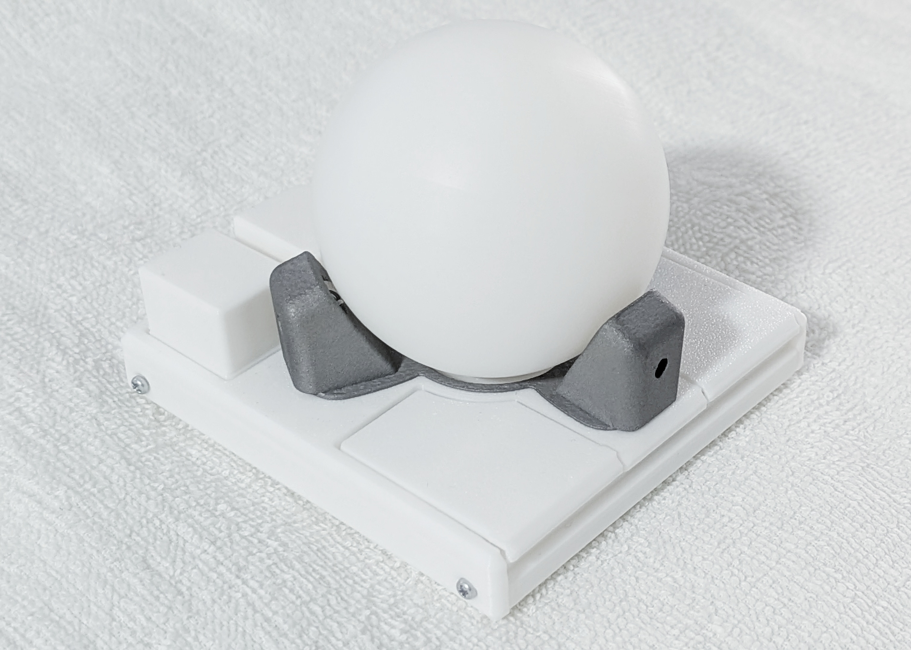
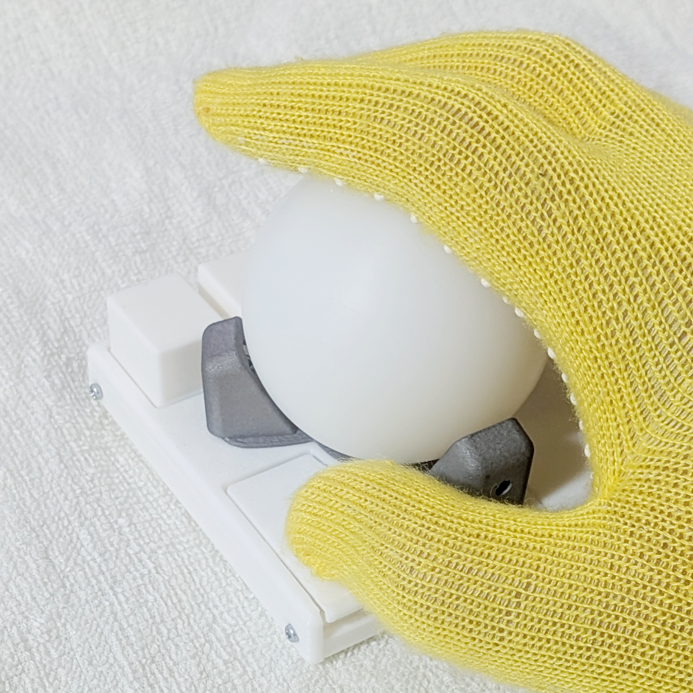

[English](README.md) | 日本語

> トラックボールはKensington SlimBlade ProとElecom Comfyを買えばゴールであるとされている。  
> しかしもっと小さい筐体は実現できないものだろうか。

# GOTOKU-55 トラックボール

## これは何？
これは、55mmトラックボールの**「部品」**です。順に知る必要があります。

### Ploopy Adept
カナダの小さな会社Ploopyが開発した、44mm玉(1.75in ≒ 44.5mm)のトラックボールがAdeptです。設計データとファームウェアはオープンソースで公開されていますが、部品を自分で揃えると寸法が合わないことがあるため、Ploopy公式ストアでキットか組み立て済み品を買うことが推奨されています。

- リンク: [Adept Trackball](https://ploopy.co/adept-trackball/)

#### 日本在住者向けの特記事項
カナダから日本への郵送は私の場合1か月以上を要し、あまり愉快な体験ではありませんでした。国際郵便ネットワークを悪くいうつもりはありませんが、Amazon.comなどの海外通販で何かを購入するような感覚とは明らかに違います。  
最も入手難と思われる光学センサPixArt PMW3360が遊舎工房で販売されているため、PCB作成や3Dプリントに明るい人は自作したほうが早い可能性があります。レンズはLM19-LSIを使用することに注意してください。  
JLCPCBを利用する際は最小注文数が5枚になるため、興味のある友人を募って共同で作ってみるのもよいかもしれません。

### Adept Anyball
Adept Anyballは、Adeptのケースを作り替えて、ボールの支持をBTU（ボールトランスファユニット）に変える改造のプロジェクトです。ケースの種類を選ぶことで、34mmの小玉から68mmのビリヤード球まで使えます。データはGitHubで公開されていて、3Dプリンタで出力して組み立てます。

もちろん55mm版もあるのですが、筐体はやや大型であり、多くの人がリストレストを付け足しているようです。

- リンク: [Adept Anyball](https://github.com/adept-anyball/)

#### メモ: トラックボール支持方式
現在市販されている製品の多くはセラミック球などによる静的支持です。これは静音で安価で小型ですから今後も主流であり続けるでしょう。一方でどうしても摩擦による抵抗がある程度ある形式であり、快適さを求めて操作球のコーティングなどが多くのユーザによって試されてきました。

ボールベアリングによる支持は廃れていましたが、最近になってその快適さが見直され、エレコムの「IST」や「HUGE」にもボールベアリング支持のモデルがあるなど、復権しつつあるようです。摩擦抵抗が小さく、カーソルを少しだけ精密に動かしたいといった要求では静的支持よりも圧倒的に良い体験となります。これは特別な操作ではなくデスクワークでは頻繁に発生するシチュエーションですから、大きな改善をもたらす変更になります。

Ploopyが基本的に採用しているのはボールベアリング支持ですが、BTU（ボールトランスファユニット）という特殊な部品を用いて支持を行う方式が最近は人気を集めています。BTU化のブームをリードしているのがAnyballプロジェクトであるようです。BTUは物体を支えるための球体の底に回転を滑らかにするための極小の球体を敷き詰めた構造で、産業機械などで重いものを運ぶための土台として使われたりキャスターとして使われたりします。  
ボールベアやボールキャスターとも呼ばれ、特定の軸だけに回転するボールベアリングよりも回転の自由度が高いためトラックボール支持方式として最も理想的であるとされることもあるようです。

### ploopy-adept-small-btu v4 (Slim)
Anyballのプロジェクト内で公開されている、Fabricio Bastian氏による34mm/38mm玉用の小型ケースです。分割キーボードの間に配置するため極限まで低背化されていて、デザインも非常に美しく洗練されています。  
おそらくボタン部の高さだけでいえば市販最小級のKeychron Nape Proよりも低いと思われます。薄型キーボードを好むなら魅力的です。

- リンク: [adept-anyball/ploopy-adept-small-btu](https://github.com/adept-anyball/ploopy-adept-small-btu)

### GOTOKU-55
ploopy-adept-small-btu v4に55mm球を乗せるのはかなり厳しいです。図の上で考えると球も支える腕部品も巨大でボタンを覆い隠すほどです。しかし筋の悪そうなアイデアであるこれも、製作してみると案外使えるものでした。  
アンバランスな見た目に驚かれるかもしれませんが、その印象ほどこれは巨大ではありません。たしかにトラックボールとしては55mmはかなり巨大なのですが野球ボールよりもずっと小さいのです。  
また、small-btuの筐体を見たときから感じていたのですが一般的なトラックボールと異なり「南半球」まで露出したデザインは、握り込むように親指を添えることで精密な操作も安定して行うことができ快適です。

私はこの美しい小型筐体に合うよう55mm球を支える腕部品を作成しました。これがGOTOKU-55です。五徳、見ての通りです。

基本的には腕部品のみでよいです。small-btu v4筐体は完成されていて美しいのでそのまま利用できます。

### 腕
腕には3つの版があります。

- **ボールベアリング用 一体版**：PLAでプリントする場合に使います。
- **ボールベアリング用 分割版**：金属でプリントする場合に使います。腕は金属、中央の床（センサレンズのカバー）は別部品でPLAです。
- **BTU用 分割版**：一応使えますがかなり無茶な形状です。こちらもセンサ部のカバーはボールベアリング用 分割版と同じ部品を使用します。

55mm球は重く、手のひらで転がすため、PLAの腕はこの力で外側にたわみます。このためSLM（金属3Dプリント、たとえばステンレス316L）で腕を金属にすることを推奨します。金属の腕ならたわみはまったく出ません。この問題は腕の金属化だけで解決できます。  
（もし形状を工夫してこの問題を解決できると思われる方がいましたら、情報提供いただけると幸いです。）

金属でプリントする場合は分割版を使ってください（BTU用は分割版のみです）。PLAの床は下から入れ、金属の腕とセンサレンズの間に挟まれるので、重い金属の腕がレンズを押すことはありません。

ボールベアリングは安価で快適です。基本的にはボールベアリングの使用をおすすめします。  
BTUはDIYトラックボール界で人気がありますが、部品が高価です。ボールベアリングは軸と直角の方向にしか転がらないため、ボールを転がすと一部のベアリングで多少のすべりが生じ、ボールをその場でひねる回転ではすべてのベアリングがすべります。BTUはどの方向にもすべりなく転がり、特にひねる回転で差が大きくなります。ただしAdeptの設計では底面の光学センサで読み取るため、ひねる回転は読み取れない軸の動きであり、機能的には意味がありません。そしてBTUはとても音がうるさいです。  
BTU化は流行っていますし抗いがたい魅力があります。ロマンを追い求める方のみご挑戦ください。

### 筐体
私の持ち方のような場合はv4のままでは支障があります。親指を寝かせて手前のボタンを操作すると、筐体の角が指にぶつかってしまうからです。

この持ち方をする人向けに、手前のボタンを縁まで拡張した改造版の筐体も作成しました。
ネジ穴などはv4のままですからトップだけプリントすればよいですが、前縁の壁部分が消失して寂しい見た目になるためボトムも作っています。  
このボタン延長版のケースはv4互換なので34mmなどsmall-btuの腕部品を使う方でもこれだけご使用いただけます。

奥のボタンは利き手側の一つしか実質的に使えません。左右対称大玉トラックボールである都合どうしても快適操作とは言い難いボタンが出てくるのは仕方がないのですが、55mmだと奥のボタン操作とともにボールにも触れてしまいがちで不快な体験が多くなります。美しいv4筐体のフラットさを失ってしまうため悩ましいのですが、奥の4つのボタンを高くするための部品も作っています。

## 互換性
small-btu v4 のみ対応。

腕は公式のsmall-btu v4筐体とGOTOKU筐体のどちらにも取り付けられます。

v5も形状が似ているので利用できる可能性がありますが、試算ではおそらくボールが少し干渉します。

## つくりかた
[製作方法](docs/BUILD_ja.md)を参照

## ライセンス
Copyright (C) 2026 Kotaro WAJIKI  
Based on ploopy-adept-small-btu v4, Copyright (C) Fabricio Bastian  
Licensed under the GNU General Public License v3.0
