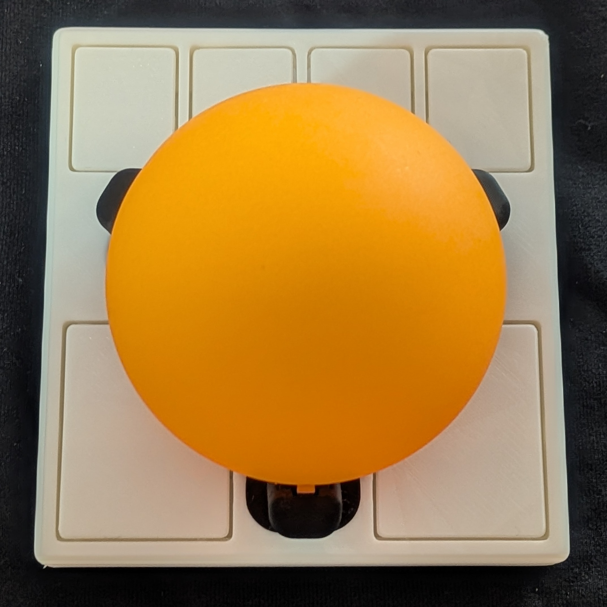
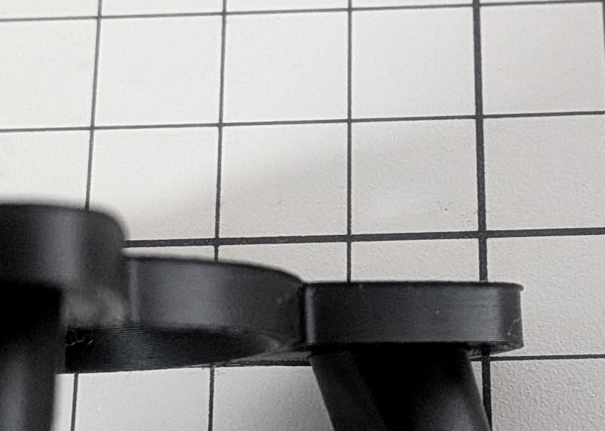

English | [日本語](BUILD_ja.md)

# Building GOTOKU-55

## Parts needed

### Electronics
- [Ploopy Adept PCB](https://github.com/ploopyco/adept-trackball/tree/master/hardware/electronics)
- [Firmware](https://github.com/ploopyco/qmk_firmware)
- PMW3360 optical sensor
  - LM19-LSI lens
- USB-C cable

Buying the Adept kit gets you all of the electronics.

### Mechanical parts
- 55 mm ball
- M2x10mm countersunk screws x4
- SMR63ZZ ball bearings x3
- (Optional) Self-adhesive rubber feet, 8 mm diameter, 1.6 mm high, x4

If you hesitate to buy an expensive 55 mm ball right away, a 55 mm table tennis practice ball is a cheap alternative.

Ball bearings rust quickly unless they are stainless steel. I recommend NSK ones.

### 3D printed parts
- [Bearing dowel (axle)](https://github.com/ploopyco/classic-2-trackball/tree/master/hardware/mechanicals)
- [Bearing press jig](https://github.com/ploopyco/classic-2-trackball/tree/master/hardware/mechanicals)
- [GOTOKU arm](../3d-model/) (choose one)
  - One-piece version, printed in PLA
    - `gotoku55-arm`
  - Split version, metal arm and PLA floor
    - `gotoku55-arm-split-metal` (metal)
    - `gotoku55-arm-split-floor` (PLA)
- Case top and bottom (choose one set)
  - [small-btu v4 case top and bottom](https://github.com/adept-anyball/ploopy-adept-small-btu/tree/main/v4)
  - [GOTOKU case top and bottom](../3d-model/)
    - `gotoku55-case-top`, `gotoku55-case-bottom`

The parts must be printed in the right orientation. As a rule, the large flat face goes on the build plate.

The arm parts also come as STEP files for metal printing. The GOTOKU case bottom also comes as a STEP file. The GOTOKU case top is STL only.

`gotoku55-assembled` shows the GOTOKU case, the one-piece arm and a 55 mm ball, put together. It is for checking how they fit. It is not for printing.

### Metal parts
I recommend the split version of the arm, printed in metal with SLM. A PLA arm bends outward under the weight of the 55 mm ball and your palm. A metal arm does not bend. I had mine printed in stainless steel 316L.

## Assembly

### Assembling the bearings
Use the jig to press a dowel into each bearing. It probably makes no difference in practice if the dowel is not perfectly centered.

Press the bearings into the GOTOKU arm part. The jig is handy for this. Once they are in, check that they spin smoothly.

Each post of the arm has a 3 mm hole on its outer side. If something goes wrong, push a toothpick into this hole to push the bearing out from behind, and start over.

### Assembling the case
If you use the split version of the arm, first put the PLA floor into the metal arm from below. The small tab on the edge of the floor goes toward the front post. The floor is held in place by the sensor lens, so it falls out when you lift the arm out of the case.

Fit the GOTOKU arm into the case top.

If the fit is tight, check whether the bottom face of the print has flared out into a thin lip. You may need to trim it a little with a file or a knife.

If the ball does not track or the buttons do not press properly, the case may need adjusting.
3D printed parts are not strong enough to be screwed together many times, so test that everything works before you drive the screws in.

### Sharing your build
An expensive trackball ball may reflect your room, or your face.
Check before you post photos of your trackball on social media.
